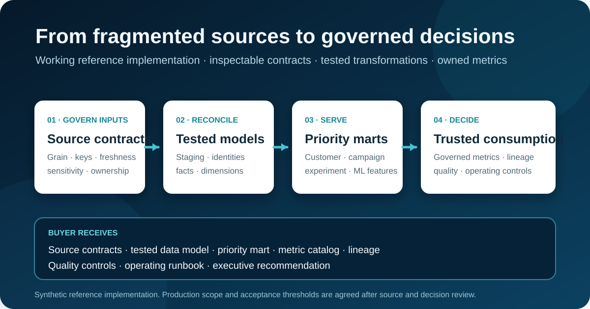

<p align="center">
  
</p>

# Governed Analytics Data Products

[](https://github.com/laura-rivera-sancho/data-architecture-standard-framework/actions/workflows/ci.yml)

**A working reference implementation for turning fragmented operational data into tested, governed, decision-ready data products.**

[Read the stakeholder summary](docs/stakeholder_readout.md) · [Review the architecture](docs/architecture_overview.md) · [Inspect the mart catalog](docs/mart_catalog.md) · [Contact Laura](mailto:laura.riverasancho33@gmail.com)

This project is for analytics, data, product, and operations leaders who need consistent customer and campaign identities, trusted metrics, reusable marts, and visible operating controls before scaling analytics or AI work.

[](docs/stakeholder_readout.md)

*Reference implementation preview—[read the stakeholder summary](docs/stakeholder_readout.md) or [inspect the architecture and controls](docs/architecture_overview.md).*

## The decision this supports

Can the organization rely on a defined set of analytical data products for customer value, campaign performance, experimentation, ML features, and executive reporting—and what controls are required before wider use?

The work makes grain, ownership, freshness, sensitivity, lineage, quality rules, and limitations explicit so consumers can judge whether a data product is fit for a particular decision.

## Data-product pilot at a glance

| Item | Typical scope |
|---|---|
| **Best for** | Teams rebuilding the same customer, campaign, experiment, or KPI logic across reports and models |
| **Duration** | 4–6 weeks for a bounded priority domain |
| **Inputs** | Source schemas and extracts; current KPI definitions; priority decisions and consumers; known quality issues; privacy and retention requirements; data and business owners |
| **Week 1** | Confirm the priority decisions, source boundaries, grains, owners, classifications, and acceptance criteria |
| **Weeks 2–3** | Implement source contracts, staging rules, identity logic, and reconciled dimensional models |
| **Weeks 4–5** | Build the priority marts and governed metric definitions; validate quality, lineage, freshness, and consumer fit |
| **Week 6** | Deliver the runbook, stakeholder readout, production gap assessment, and go / iterate / stop recommendation |
| **Buyer receives** | Source contracts, tested data model, priority mart, metric catalog, lineage, quality controls, operating runbook, and executive recommendation |
| **Not included** | Full enterprise-platform migration, unrestricted production access, every historical use case, vendor procurement, or ongoing operations after handoff |

## Acceptance criteria

Exact thresholds depend on the selected domain and source systems. At minimum:

- source-to-output counts and critical measures reconcile;
- table grain, keys, history behavior, and late-arriving-data rules are documented;
- critical identifiers, relationships, freshness expectations, and business invariants are tested;
- metrics have one declared definition, owner, aggregation behavior, lineage, and limitation;
- sensitive fields and allowed uses are visible to consumers;
- failure, recovery, and change-management responsibilities are documented; and
- the final readout identifies what is ready, what remains risky, and the recommended next investment.

## What the buyer can inspect

| Evidence | Start here | What it shows |
|---|---|---|
| Executive decision artifact | [Stakeholder readout](docs/stakeholder_readout.md) | Business value, design choices, risks, and production evolution |
| Architecture | [Architecture overview](docs/architecture_overview.md) | Layer responsibilities, ownership, governance, and downstream consumers |
| Source interface | [Customer source contract](contracts/sources/customers.yml) | Grain, keys, freshness, field semantics, and data classification |
| Transformation control | [Source-to-staging mapping](docs/source_to_staging_mapping.md) | Type normalization, deduplication, traceability, and boundaries |
| Consumer products | [Mart catalog](docs/mart_catalog.md) | Audience, decision, grain, measures, dependencies, and limitations |
| Governed meaning | [Semantic metric catalog](docs/semantic_metric_catalog.md) | Executable definitions, owners, aggregation behavior, and caveats |
| Operability | [Operations runbook](docs/operations_runbook.md) | Service signals, incident severity, recovery, and communication |
| Engineering evidence | [Automated tests](tests) and [validator](src/data_architecture/contracts.py) | Contract, integrity, governance, and critical-rule checks |
| Design rationale | [ADR-001](docs/decisions/ADR-001-portfolio-platform.md) | Explicit architectural tradeoffs and implementation boundaries |
| Technical reference | [Method notes](method_notes.md) and [evidence map](ROADMAP.md) | Concepts, limitations, implemented capabilities, and future work |

## Demonstration boundary

The organization, identifiers, data, and reported evidence in this repository are fictional or synthetic. The project demonstrates architecture judgment, contract-driven implementation, reconciliation, governance, and operability; it is not evidence that a real organization has adopted the design or achieved business outcomes from it.

## How an engagement would start

1. Select one bounded decision domain and the consumers who depend on it.
2. Review source schemas, metric definitions, known incidents, and a safe data sample.
3. Confirm the written scope, ownership, access boundary, deliverables, acceptance criteria, and exclusions.
4. Begin once source access, privacy expectations, and review responsibilities are agreed.

For an initial scope discussion, [email Laura](mailto:laura.riverasancho33@gmail.com) with the decisions the data must support, the priority sources, the current failure points, and the target timeline.

## Architecture at a glance

```text
Operational sources
    │
    ▼
Source contracts and ingestion checks
    │
    ▼
Staging models ──► Intermediate identity and business-rule models
    │
    ▼
Dimensional warehouse
    │
    ├──► customer_360 / rfm_segments
    ├──► campaign_performance / experiment_results
    ├──► ml_features
    └──► executive_growth
             │
             ▼
      Governed semantic metrics
```

See the [architecture overview](docs/architecture_overview.md) for layer responsibilities and quality controls.

## Implemented capabilities

| Capability | Evidence status | Outcome |
|---|---|---|
| **DA1 — Source Contracts & Staging** | Evidence available | Governed inputs, freshness expectations, identifiers, staging conventions, and automated checks |
| **DA2 — Dimensional Warehouse** | Evidence available | Defensible facts, conformed dimensions, declared grain, history strategy, and business rules |
| **DA3 — Business Data Marts** | Evidence available | Reusable data products for customer, marketing, experimentation, ML, and executive decisions |
| **DA4 — Semantic Governance & Operations** | Evidence available | Trusted metrics, lineage, ownership, observability, performance, and change management |

## Repository map

```text
data-architecture-standard-framework/
├── .github/workflows/       # Automated repository-quality checks
├── contracts/
│   ├── schema.yml           # Contract format and governance rules
│   └── sources/             # Version-controlled operational source contracts
├── docs/
│   ├── decisions/           # Architecture decision records
│   ├── architecture_overview.md
│   ├── source_to_staging_mapping.md
│   ├── staging_failure_runbook.md
│   ├── dimensional_model.md
│   ├── mart_catalog.md
│   ├── da2_evidence.md
│   ├── da3_evidence.md
│   └── da4_evidence.md
├── operations/              # Service-level and operational declarations
├── semantic/                # Executable metrics and product lineage
├── src/data_architecture/   # Reusable validation and modeling utilities
├── tests/                   # Contract and repository-integrity tests
├── warehouse/               # Ordered SQL models and declared quality checks
├── method_notes.md          # Reusable concepts, tradeoffs, and reference questions
├── ROADMAP.md               # Capability evidence and readiness criteria
└── README.md                # Repository overview and navigation
```

## Quick start

Requirements: Python 3.11 or 3.12.

```bash
python -m venv .venv
source .venv/bin/activate  # Windows PowerShell: .venv\Scripts\Activate.ps1
python -m pip install --requirement requirements-dev.txt
python -m data_architecture.contracts contracts/sources
python -m data_architecture.synthetic_data data/generated/raw
python -m data_architecture.staging data/generated/raw contracts/sources data/generated/staged --staged-at 2026-08-30T13:00:00Z
python -m data_architecture.warehouse data/generated/portfolio.duckdb data/generated/staged --manifest data/generated/warehouse_manifest.json
python -m data_architecture.governance data/generated/portfolio.duckdb data/generated/warehouse_manifest.json data/generated/staged/staging_manifest.json --report data/generated/governance_report.json
ruff check .
pytest
```

## Design principles

- Declare grain before defining columns or measures.
- Treat source expectations and business semantics as version-controlled interfaces.
- Separate source-aligned staging from reusable business logic and consumer-facing marts.
- Test identifiers, relationships, accepted values, freshness, and business invariants.
- Make ownership, sensitivity, lineage, and limitations visible to consumers.
- Define metrics once and reuse them consistently.
- Prefer simple, inspectable architecture until scale or service requirements justify complexity.

## Related work

This is the Data Warehousing, Data Marts & Data Modeling pillar of the broader [public portfolio](https://github.com/laura-rivera-sancho). Its governed marketing data products are designed to support the RFM, experimentation, and campaign-response case studies across the Analytics and Machine Learning repositories.

## License and citation

This project is available under the [MIT License](LICENSE). Citation metadata are provided in [CITATION.cff](CITATION.cff).
